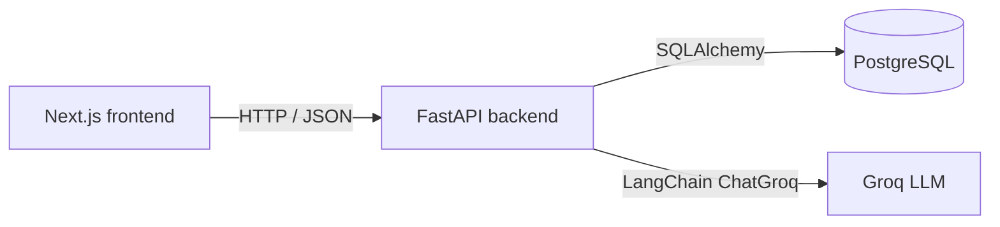

# GradeLens Architecture

## Overview

GradeLens is a monorepo with a Python/FastAPI backend and a Next.js App Router frontend. PostgreSQL is the single source of truth, accessed through SQLAlchemy 2 with Alembic migrations.

## Backend layers

| Layer | Responsibility |
|-------|----------------|
| `routers/` | HTTP route handlers, request/response schemas |
| `services/` | Business logic (auth, grading, reports) |
| `models/` | SQLAlchemy ORM entities and relationships |
| `deps.py` | JWT verification and role-based dependencies |
| `schemas/` | Pydantic request/response validation |

## Authentication

- Passwords are hashed with bcrypt via passlib.
- JWT access tokens include `sub` (user id) and `role`.
- TOTP 2FA uses pyotp. During login, users with 2FA enabled receive a short-lived `scope=2fa` temp token; they exchange it plus a TOTP code for a full access token.
- The frontend stores the JWT in `localStorage` and sends it as a Bearer token. This tradeoff is documented here because Next.js client-side auth is simplest with localStorage; switching to httpOnly cookies is recommended before production.

## Authorization

- `get_current_user` validates the access token and rejects `scope=2fa` tokens on normal routes.
- `require_role("teacher" | "student")` returns HTTP 403 for mismatched roles.
- Every data query is filtered by the authenticated user's id (to be enforced as business endpoints are added).

## Preview integration

In the platform preview both services run on the same VM:

- `npm run dev` runs `alembic upgrade head` and starts uvicorn on port 8000.
- Next.js starts on the `PORT` supplied by the preview (3000 locally).
- `next.config.js` rewrites `/api/:path*` to `http://localhost:8000/:path*`, so the frontend uses relative `/api` URLs and no separate backend public URL is needed.
- Backend CORS includes `FRONTEND_URL` plus `localhost:3000`, and falls back to allowing any origin when `FRONTEND_URL=*` or `PREVIEW_MODE=true`.

## Database

Core tables: Users, Classes, Enrollments, Assignments, Questions, Submissions, Answers, FeedbackReports.

- Unique email per user.
- Unique join code per class.
- Unique enrollment per student + class.
- Answers store AI draft fields; these are never exposed to student routes until approved.

### Schema management

- Local development uses Alembic migrations in `backend/alembic/versions/`.
- Platform previews also apply `db/migrations/0001_initial_core_tables.sql` during the build. The migration seeds `alembic_version` to revision `000000000001` so the backend's `alembic upgrade head` command recognises the schema and does not try to recreate tables.
- The Alembic revision uses `if_not_exists=True` so it is safe to run even when the platform migration has already created the tables.

### Runtime fixes

- `bcrypt==4.0.1` is pinned before `passlib[bcrypt]` because passlib 1.7.4 is incompatible with bcrypt >= 4.1.
- `JWT_SECRET` falls back to `SESSION_SECRET` when the former is missing or shorter than 32 characters; the app fails to start with a clear error if neither is usable.
